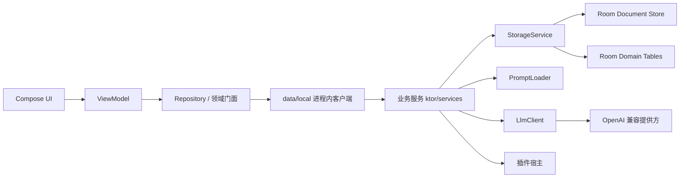

# 系统架构

本文档描述造梦当前的主实现。旧 Python/Web 目录仅作为行为基线，不属于目标架构。

## 总览

造梦是**纯 Android 单模块应用**，本地优先：UI、业务服务与数据库都在同一个进程里，
数据保存在 Room/SQLite 中；只有模型请求、在线书库和显式下载会访问外部网络。

历史背景：这个工程曾是 KMP 多模块 + Compose Multiplatform 工程，并在进程内起一个
Ktor CIO HTTP 服务端，客户端通过 `localhost` HTTP/SSE 调回自己。单模块化之后那条往返
被整体删除——见下文「为什么没有 HTTP 层」。



## 工程结构

单模块：`kmp/settings.gradle.kts` 只 `include(":app:androidApp")`。

| 目录 | 职责 |
| --- | --- |
| `app/` | 应用入口：Application、MainActivity、更新器 |
| `data/api/` | DTO 与跨层稳定契约 |
| `data/local/` | **进程内客户端**：按领域直接调用业务服务 |
| `data/library/`、`data/update/` | 对外网络：在线书库下载、更新检查 |
| `data/*.kt` | Repository 实现与领域门面 |
| `ktor/services/` | 业务服务层（对话、章节、人物、插件、诊断……） |
| `ktor/features/` | 功能自检探针与判定规则 |
| `ktor/providers/` | 提供方能力探测等辅助 |
| `ktor/models/`、`ktor/utils/` | 服务层模型与解析器 |
| `db/` | Room 数据库、DAO、`DomainStore` |
| `domain/` | 用例与 Gateway 契约 |
| `feature/*` | 按业务拆分的 Screen / ViewModel |
| `platform/` | 平台能力：日志、安全存储、HTTP 引擎、诊断采集 |
| `di/` | Koin 装配 |

`ktor/` 这个包名是历史遗留：这里以前确实是内嵌 Ktor 服务端，现在只剩业务服务与探针。
改名会牵动数百个文件却只换来名字好看，因此保留——**但 `ktor.services.*` 是进程内业务服务，不是服务端。**

## 为什么没有 HTTP 层

原先每个功能域都有一对「Ktor client ↔ Ktor route」：客户端把调用序列化成 HTTP 请求打到
`127.0.0.1` 的随机端口，路由再反序列化、调服务、把结果序列化回去。这条链路没有带来任何
隔离收益（同一进程、同一份数据、同一个用户），却引入了：端口与鉴权、SSE 编解码、
`ContentNegotiation` 配置漂移、以及「服务端序列化失败 → 500 → 客户端解码失败」这类
只在运行期暴露的故障面。

现在替换为：

```
Repository → data/local/<域>Client → ktor/services/<域>Service → Storage / LLM
```

关键约束（改动服务返回形状时必须一起动）：

- 服务返回 `JsonObject` 时，进程内客户端用**与原先完全一致**的 `Json` 配置解码成 DTO，
  保证 DTO 形状与解码行为不变；
- 服务本来就返回类型化 DTO 时，客户端直接返回，连解码都省掉；
- 少数路由原本带**响应整形逻辑**（如 `OriginalKnowledge` 的 `items` 组装、
  `withTranscriptCount` / `leanSession` 的选择），这些逻辑已原样搬进对应客户端——
  它们本来就是「响应构造」，去掉 HTTP 后自然属于客户端一侧。

## 请求路径

1. UI 把用户事件交给 ViewModel。
2. ViewModel 生成 operation ID，通过 Repository 请求。
3. Repository 经 `data/local/` 的进程内客户端调用业务服务。
4. 服务读取有界会话上下文、人物资料、世界状态、记忆与原文检索片段。
5. `DialoguePayloadBuilder` / `PromptBuilder` 生成模型消息，`LlmClient` 请求外部提供方。
6. 模型侧 NDJSON 由流式解析器增量投影为可见对话事件。
7. 事件以 `Flow<DialogueStreamEvent>` 直接进入 ViewModel，幂等合并到 UI。
8. 结构校验成功后提交 turn 与 session manifest；派生记忆/状态在后台合并。

## 对话流式协议

模型侧多角色协议采用 NDJSON：

```jsonl
{"speaker":"角色甲","message":"第一句。"}
{"speaker":"旁白","message":"门外风声渐紧。"}
```

服务端不等待整份响应结束：当前行 `speaker` 已完整且 `message` 开始到达时，
增量投影器即可发出可见文字。最终提交仍要求至少存在一条通过 speaker 白名单与字段校验的完整响应。

对 UI 暴露的事件（`DialogueStreamEvent`，**进程内直接产出，不再有 SSE 文本层**）：

- `Status`：生成阶段提示；
- `Delta`：角色台词、场景或推理增量；
- `Reset`：结构失败后重试，客户端清除上一版临时输出；
- `Complete`：提交成功，携带轻量 session 与本轮 transcript 增量；
- `Failure`：失败信息及可重试标志。

## 提示词与上下文

`DialoguePayloadBuilder` 汇总运行状态，`DialoguePromptBuilder` 负责压缩和分区。上下文主要包括：

- 近期 transcript；
- 参与角色资料和关系；
- scene progress 与世界事实；
- 用户管理的记忆与长期记忆；
- 当前输入及插件增强；
- 原作动态检索出的少量证据。

提示词源位于 `prompts/`，唯一的内置副本是 `kmp/app/androidApp/src/main/assets/`。
**两处内容必须逐字节一致**，改完跑 `./scripts/check-prompt-sync.sh` 做双向校验。

## 原文检索

小说全文和 `original_knowledge.json` 是本地证据库，不会整份发送给模型。系统在本地建立/缓存
可检索结构，每轮根据用户输入、角色和场景检索少量条目；PromptBuilder 再限制条目数量与单条长度。

该设计把原文 IO/索引成本与模型 token 成本分离：读取本地文件不消耗模型 token，
只有注入提示词的摘录消耗 token。

## 持久化

`StorageService` 提供统一路径与原子读写语义。生产环境由两类 Room 数据共同支撑：

- `documents`：按路径保存 JSON、Markdown、原文、资源等业务文档；
- 领域表：runs、sessions、messages、cards、personas 等，用于索引、列表和分页。

`DomainStore` 在已识别文档写入/删除时同步领域表。任何新增文档类型都要评估是否需要同步规则。

### 会话历史

session manifest 只保留近期 transcript。当条目超过阈值时，旧条目成批移动到 archive 文档，
manifest 保存 `transcript_start` 和 `transcript_count`。生成路径读取轻量 manifest；
详情和分页路径按需物化完整历史。

### 大型资源

重新蒸馏上传的原文使用内容摘要去重。运行时关系图使用结构化关系资料，
而不是为每个 run 保存一份 JS runtime。

## 后端启动生命周期

虽然没有 HTTP 服务端了，但应用仍需要一个「可以开始用了吗」的状态：
书架页据此显示「正在准备 / 就绪 / 失败 + 重试」，前台服务也会在失败时重试。

`InProcessBackendController` 负责这一件事：构建进程内服务图（打开 Room、初始化存储与服务），
成功置 `BackendState.Ready`，失败置 `BackendState.Failed` 并把原因原样交给用户。
服务图本身由 `AppServices` 懒持有；预热只是把「可能失败的初始化」提前到用户能看到原因的时刻。

## 并发与幂等

- operation ID / turn ID 标识一次用户发送，用于断线恢复和重复请求判断。
- 同一 session 的 manifest 提交受会话级互斥保护。
- 后台状态、世界记忆和长期记忆任务按 session 合并，不能覆盖更新后的前台提交。
- 客户端按 turn ID 合并 complete 增量，避免断线重放造成历史重复。

## 安全边界

- 模型 API key 存在平台安全存储，不进入 Room 文档或导出包。
- ZIP、插件、模型响应、用户文本和路径参数全部视为不可信输入。
- 应用内不再监听任何端口，也就不存在「本地服务意外暴露到网络」这一类风险。
- 诊断日志只记录截断文本和阶段指标，避免泄露完整原文、对话或密钥。

## 相关决策

- [ADR-0001：本地内嵌 KMP 后端](adr/0001-local-embedded-kmp-backend.md)（**已被本次重构取代**：
  内嵌 HTTP 服务端已移除，业务服务改为进程内直接调用；ADR 作为历史决策保留）
- [ADR-0002：多角色对话采用 NDJSON 流式协议](adr/0002-ndjson-dialogue-streaming.md)
- [ADR-0003：会话 transcript 有界清单与分块归档](adr/0003-bounded-transcript-archive.md)
- [ADR-0004：原文使用本地检索摘录](adr/0004-retrieved-source-excerpts.md)

## 历史归档

- [`archive/server-api.md`](archive/server-api.md)：已废弃的 HTTP 接口文档，
  仅供与旧 Python 实现做行为对照。
